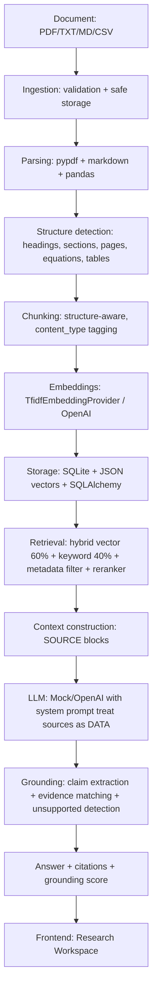
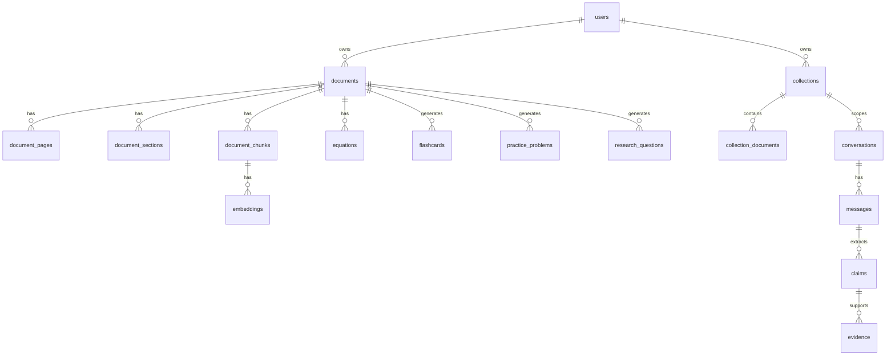

# Architecture

## High-level



## Database Schema



See `backend/app/models/*.py` for 18 tables with migrations via `init_db()`; Alembic ready.

## Backend Layout

```
backend/app/
  main.py              FastAPI + CORS + observability middleware
  config.py            Settings (pydantic-settings, lru_cache)
  database.py          Engine/Session/Base/init_db
  core/
    llm_provider.py    LLMProvider abstract + Mock + OpenAI
    embedding_provider.py TFIDF + OpenAI
    reranker.py        SimpleReranker
    security.py        validation, path traversal, injection check
  services/
    parsing.py         PDF/TXT/MD/CSV extraction
    chunking.py        structure-aware
    ingestion.py       parse→chunk→embed pipeline
    retrieval.py       hybrid + metadata filtering
    rag.py             RAG + multi-doc comparison
    grounding.py       claim extraction, grounding score, hallucination checks
    explanation.py     4-level STEM explanations
    equations.py       extraction + variable explanation
    flashcards.py, problems.py, questions.py, dataset.py, paper_analysis.py, lab_manual.py, citations.py, evaluation.py, observability.py
  api/
    documents.py, rag.py, learning.py, collections.py, analysis.py, conversations.py, evaluation.py, search.py
```

## Frontend Layout

```
frontend/src/
  api/client.ts        axios + typed endpoints
  App.tsx              Workspace layout: Documents | Research Workspace | Evidence/Equations/Flashcards/Problems
  styles/index.css     scientific clean theme, badges source/generated
```

Layout:
```
┌──────────────────────────────────────────────┐
│ AI STEM RESEARCH ASSISTANT (health, grounded toggle)│
├───────────────┬──────────────────────────────┤
│ Documents     │                              │
│ Collections   │ Research Workspace           │
│ Scope         │ Chat / Analysis + grounding  │
│ Search        │                              │
├───────────────┴──────────────────────────────┤
│ Evidence │ Equations │ Flashcards │ Problems │
└──────────────────────────────────────────────┘
```

## Model Abstraction

```python
class LLMProvider(ABC): generate(prompt, system, temp) -> str
class EmbeddingProvider(ABC): embed_texts(texts) -> vectors, embed_query(q) -> vector
class RerankerProvider(ABC): rerank(query, candidates, top_k) -> ranked
```

Swap via `LLM_PROVIDER`/`EMBEDDING_PROVIDER` env; no API keys committed.

## Cost Control

- Retrieval before generation (only top-k chunks sent, not full PDF)
- Embedding reuse (stored vectors), chunk reuse, request batching
- Caching via provider singletons, no unnecessary LLM calls

## Observability

Middleware logs `request_id, user_id, document_id, retrieval_latency, llm_latency, retrieved_chunks, model_used, errors, grounding_evaluation`. Never logs API keys or sensitive document contents.
